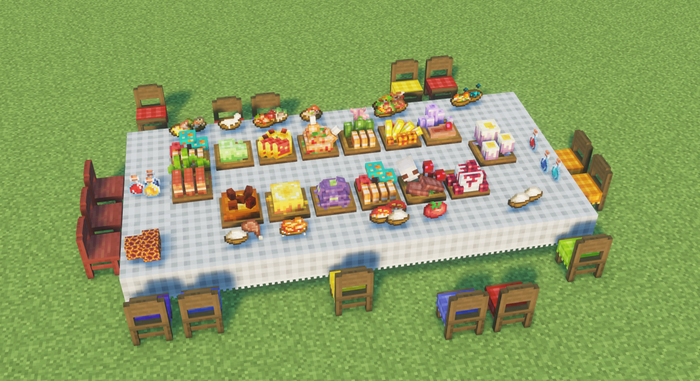

# Kaleidoscope Cookery Unofficial 26 · 森罗物语：厨房（非官方移植）

<p align="center">
  
</p>

<p align="center">
  <a href="#"></a>
  <a href="#"></a>
  <a href="#"></a>
  <a href="#"></a>
</p>

> 我太想在更高版本的 Minecraft 上玩到森罗物语：厨房了，于是自己动手做了这个早期移植，纯粹为了满足自己的念想。
>
> 本构建在 AI 辅助下完成。它实现了原版 Kaleidoscope Cookery 的绝大部分功能，但仍可能存在少量 bug。发现问题欢迎提交 issue，我会尽力修复。

> 以下介绍部分沿用官方原始文档。

---

## 📖 简介

**Kaleidoscope Cookery（森罗物语：厨房）** 是一个为 Minecraft Java Edition 开发的模组，致力于带来丰富的烹饪体验与全新的游戏内容。

本仓库是它的**非官方 NeoForge 26.x 移植版**，目前同时维护 **26.1.2 / 26.2 / 26.3** 三个 Minecraft 版本，每个版本对应一条独立分支。

---

## ✨ 功能特性

### 🍳 完整的烹饪体系
- 全新的烹饪系统与丰富的食物配方
- 煎、炒、烹、炸、蒸、烤多线并行

### 🔥 创新烹饪设备

| 设备 | 用途 |
|---|---|
| 灶台（Stove） | 基础热源与烹饪工作站 |
| 炒锅（Pot） | 炒制类料理 |
| 汤锅（Stockpot） | 炖煮、熬汤、糖浆 |
| 蒸笼（Steamer） | 蒸制类料理 |
| 茶壶（Teapot） | 冲泡茶饮 |
| 石磨（Millstone） | 研磨原料 |
| 砧板（Chopping Board） | 切配食材 |
| 烤肉架（Shawarma Spit） | 旋转烤肉 |
| 油壶（Oil Pot） | 储油与浇油 |
| 橱柜（Kitchen Shelf） | 厨具与食材收纳，支持红石自动补充 |

### 🥘 丰富的内容规模
- **569** 个模组配方
- **69** 个方块 / **147** 个物品
- 完整进度树（Advancement）
- 厨师村民职业与村庄厨房结构
- 果串（Skewer）家族：浆果、苹果、毛毛虫及裹糖变体

### 🎮 沉浸式体验
- 手持物品动态模型（油壶、面团、锅盖、菜谱等）
- 烹饪进度 HUD、锅具动画、汤底渲染
- 可选联动：**JEI** / **Jade** / **REI**（均为可选，不装也能正常游玩）

---

## 🖼️ 展示


---

## 📦 版本与分支

| 分支 | Minecraft | NeoForge | `mod_version` |
|---|---|---|---|
| [`26.1.2`](../../tree/26.1.2) | 26.1.2 | 26.1.2.94+ | `1.4.1-release-neoforge+mc26.1.2` |
| [`26.2`](../../tree/26.2) | 26.2 | 26.2.0.67+ | `1.4.1-release-neoforge+mc26.2` |
| [`26.3`](../../tree/26.3) | 26.3 | 26.3.0.118+ | `1.4.1-release-neoforge+mc26.3` |

> 每个版本分支独立维护，请下载与你的 Minecraft 版本对应的分支构建。

---

## 🔧 安装

1. 安装对应版本的 **NeoForge**（见上表）
2. 安装 **Java 25+**
3. 将构建出的 jar 放入 `.minecraft/mods/`
4. 启动游戏

**前置模组**：无强制前置。JEI / Jade / REI 为可选联动。

---

## 🛠️ 从源码构建

```bash
git clone https://github.com/Kansamu216/KaleidoscopeCookery-26-Neo.git
cd KaleidoscopeCookery-26-Neo
git checkout 26.3          # 或 26.2 / 26.1.2

./gradlew build
```

构建产物位于 **`build-local/libs/`**（注意：本项目的 `buildDirectory` 被设为 `build-local`，不是默认的 `build/`）。

### 环境要求

| 项 | 版本 |
|---|---|
| JDK（编译目标） | 25 |
| JDK（NeoForm Runtime） | 26 |
| Gradle | 9.2.1（通过 wrapper） |
| ModDevGradle | 2.0.143 ~ 2.0.148（按分支） |

> 需要同时提供 JDK 25 与 JDK 26，并通过 `-Dorg.gradle.java.installations.paths=<jdk25>,<jdk26>` 显式登记，否则 NeoForm 任务会失败。

---

## ✅ 验证状态

三个版本均通过以下验证：

| 项 | 26.1.2 | 26.2 | 26.3 |
|---|---|---|---|
| `./gradlew clean build` | ✅ | ✅ | ✅ |
| GameTest | ✅ 13/13 | ✅ 13/13 | ✅ 13/13 |
| 模组配方数 | 569 | 569 | 569 |
| 数据解析错误 | 0 | 0 | 0 |
| loot `Unreachable entry` | 0 | 0 | 0 |
| GitHub Actions | ✅ | ✅ | ✅ |

---

## ⚠️ 已知限制

| 项 | 说明 | 影响 |
|---|---|---|
| `datagen/**` | NeoForge 26.x 删除了旧 datagen API，待从零重写 | 仅影响开发期，不影响游玩 |
| `compat/{emi,create,farmersdelight,ponder,harvest}` | 上游均无 26.x 构建 | 装对应 mod 时无联动 |
| `compat/rei` 的磨石/汤锅分类 | 依赖 Create / Farmer's Delight | REI 中少 2 个配方分类 |
| 生物掉落表（猪/猪灵等） | loot table 格式迁移待完成 | 相关掉落暂缺 |
| 旧 `client/render`、`client/init` | 已被 `client/runtime` 适配层取代 | 无 |

> 详细说明见 [Issue #2](https://github.com/BuaichiZY/KaleidoscopeCookery-26_Neo/issues/2)。

---

## 📄 许可证

本项目采用双许可协议：

- **源代码**：[BSD 3-Clause License](LICENSE-CODE.txt)
- **资源文件**：[CC BY-NC-SA 4.0](LICENSE-ASSETS.txt)

---

## 💬 反馈与建议

- 🐛 [Issues](../../issues) — 提交 bug 报告
- 💡 [Issues](../../issues) — 功能建议与讨论

---

## 👥 开发团队

**Kaleidoscope Official Production Team**（原作者）

**本移植版**：Kansamu216（非官方）

---

*感谢所有为本项目做出贡献的开发者和玩家！*
